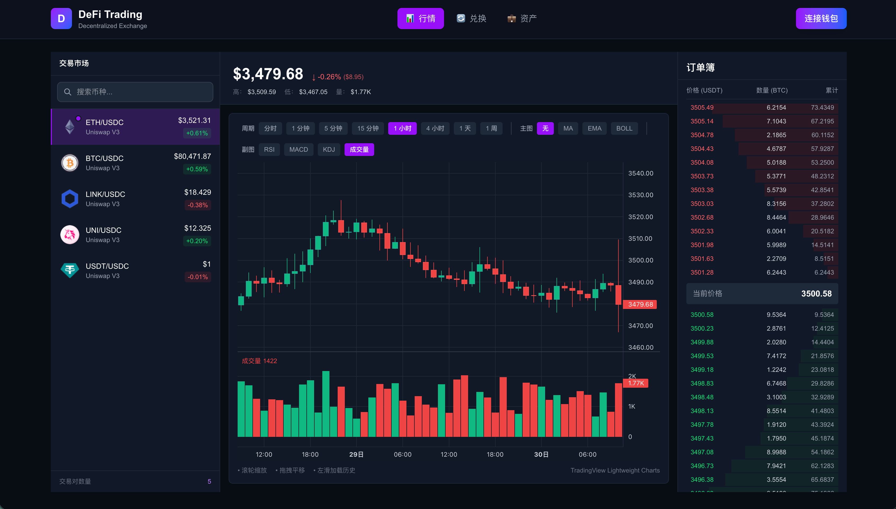
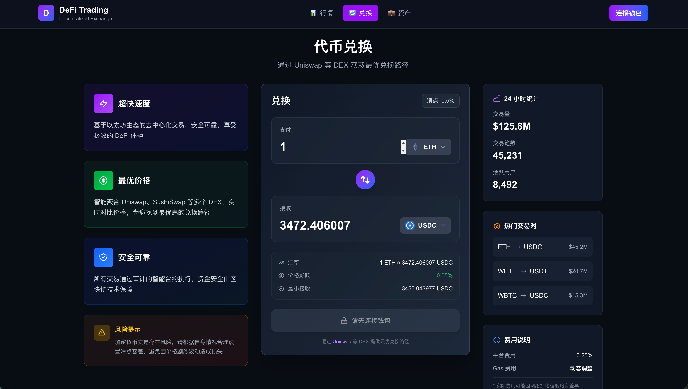
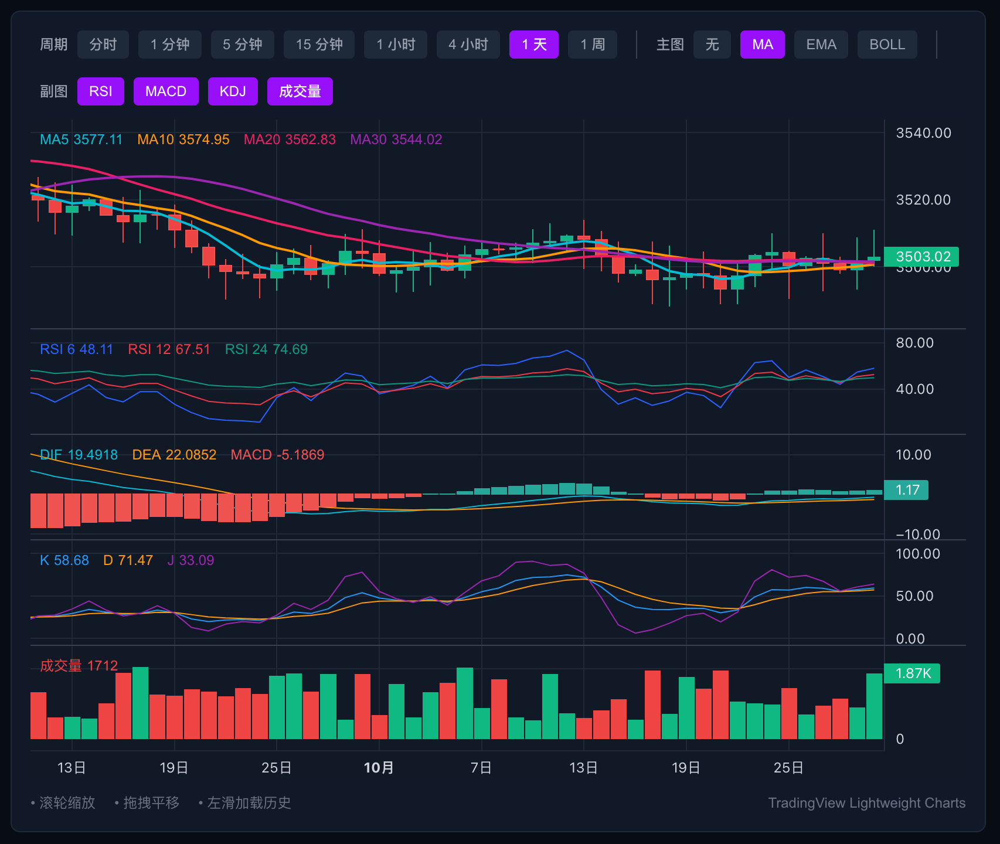

# 🚀 DeFi Trading Platform

<div align="center">


**一个用于学习 Web3 前端开发的 DeFi 交易平台项目**

> 📌 **学习目的**: 本项目是个人学习 Next.js + Web3 技术栈的实践项目，主要用于面试展示和技术探索。

[在线演示](https://defi-platform-udr2.vercel.app/)

</div>

---

## 📖 项目简介

这是一个基于 Next.js 14 和 TypeScript 开发的 DeFi 交易平台前端项目，用于学习和实践现代 Web3 开发技术。项目实现了 K 线图表、实时数据推送、代币兑换等核心功能，适合作为面试作品或学习参考。

### 🎯 学习目标

- 📊 学习 TradingView Lightweight Charts v5 的使用
- 📈 掌握 WebSocket 实时数据推送和状态管理
- 🔄 了解 DeFi 交易流程和 Web3 钱包集成
- ⚡ 实践 Next.js 14 App Router 和性能优化
- 🎨 提升 TypeScript 和现代前端工程化能力

## ✨ 已实现功能

- 📊 **K 线图表** - 使用 Lightweight Charts，支持多周期切换（1m/5m/15m/1h/4h/1d/1w）
- 📈 **实时行情** - WebSocket 模拟数据推送，支持 K 线、订单簿、Ticker 更新
- 🔄 **代币兑换** - 基本的 Swap UI 和交互流程（Mock 数据）
- 💼 **钱包连接** - 集成 RainbowKit，支持 MetaMask 等钱包
- 📱 **响应式布局** - 使用 Tailwind CSS，适配不同屏幕尺寸

## 🖼️ 项目预览

<div align="center">

### 行情页面


### 代币兑换


### K 线图表


</div>

## ⚠️ 项目说明

- **数据来源**: 当前使用 Mock 数据模拟实时行情，未接入真实区块链数据
- **功能范围**: 主要实现前端交互和 UI 展示，后端逻辑和智能合约交互为简化版
- **开发目的**: 用于学习 Web3 前端技术栈，展示个人技术能力，不用于生产环境

## 🛠️ 技术栈

<table>
  <tr>
    <td align="center" width="120">
      
      <br>Next.js 16
    </td>
    <td align="center" width="120">
      
      <br>TypeScript
    </td>
    <td align="center" width="120">
      
      <br>React 19
    </td>
    <td align="center" width="120">
      
      <br>Tailwind CSS
    </td>
  </tr>
</table>

### 核心依赖

| 技术 | 版本 | 用途 |
|------|------|------|
| [Next.js](https://nextjs.org/) | 16.4.2 | React 框架，SSR/SSG |
| [TypeScript](https://www.typescriptlang.org/) | 5.0+ | 类型安全 |
| [Lightweight Charts](https://tradingview.github.io/lightweight-charts/) | 5.2.1 | 专业金融图表 |
| [Zustand](https://github.com/pmndrs/zustand) | 5.0+ | 状态管理 |
| [Wagmi](https://wagmi.sh/) | 2.12+ | 以太坊钱包连接 |
| [RainbowKit](https://www.rainbowkit.com/) | 2.1+ | 钱包 UI 组件 |
| [Tailwind CSS](https://tailwindcss.com/) | 4.0+ | CSS 框架 |

## 🚀 快速开始

### 前置要求

- Node.js 18.0 或更高版本
- npm 或 yarn 或 pnpm

### 安装

```bash
# 克隆项目
git clone https://github.com/yourusername/defi-platform.git

# 进入项目目录
cd defi-platform

# 安装依赖
npm install
```

### 配置环境变量

复制 `.env.example` 文件并重命名为 `.env.local`：

```bash
cp .env.example .env.local
```

编辑 `.env.local` 文件：

```env
# Bitquery API Key (可选，用于真实链上数据)
# 获取地址: https://bitquery.io/
NEXT_PUBLIC_BITQUERY_API_KEY=your_api_key_here
NEXT_PUBLIC_USE_BITQUERY=false

# 以太坊 RPC URL
NEXT_PUBLIC_ETHEREUM_RPC_URL=https://eth.llamarpc.com

# 网络环境
NEXT_PUBLIC_NETWORK=mainnet
```

### 启动开发服务器

```bash
npm run dev
```

打开浏览器访问 [http://localhost:3000](http://localhost:3000)

### 构建生产版本

```bash
npm run build
npm run start
```

## 📁 项目结构

```
defi-platform/
├── app/                      # Next.js 14 App Router
│   ├── page.tsx             # 首页
│   └── market/              # 行情模块
│       ├── page.tsx         # 行情页面
│       ├── swap/            # 兑换页面
│       └── portfolio/       # 资产页面
├── components/               # React 组件
│   ├── Chart/               # K 线图组件
│   │   ├── KlineChart.tsx
│   │   └── hooks/           # 图表相关 Hooks
│   ├── OrderBook/           # 订单簿组件
│   ├── Ticker/              # 行情面板
│   ├── Swap/                # 兑换组件
│   ├── Wallet/              # 钱包组件
│   └── Layout/              # 布局组件
├── services/                 # 服务层
│   ├── websocket/           # WebSocket 服务
│   ├── bitquery/            # Bitquery API
│   ├── price/               # 价格服务
│   └── mock/                # Mock 数据
├── stores/                   # Zustand 状态管理
│   ├── kline/               # K 线状态
│   ├── depth/               # 深度状态
│   ├── wallet/              # 钱包状态
│   └── market/              # 市场状态
├── hooks/                    # 自定义 Hooks
├── types/                    # TypeScript 类型定义
├── constants/                # 常量配置
├── utils/                    # 工具函数
└── docs/                     # 文档
```

## 🎯 核心功能

### 1. 实时 K 线图表

- ✅ 多周期支持：1分钟、5分钟、15分钟、1小时、4小时、1天、1周
- ✅ 基础图表交互：缩放、平移、十字光标
- ✅ 实时数据更新（Mock WebSocket 模拟）
- ⏳ 技术指标（计划中）
- ⏳ 画线工具（计划中）

### 2. 实时订单簿

- ✅ 买卖盘展示（Mock 数据）
- ✅ 价格闪烁动画
- ✅ 基础深度可视化

### 3. 代币兑换

- ✅ Swap UI 交互界面
- ✅ 钱包连接和授权流程
- ⏳ 真实链上交易（计划中）

### 4. 钱包管理

- ✅ RainbowKit 集成
- ✅ MetaMask、WalletConnect 支持
- ✅ 账户连接和断开

## 🏗️ 架构设计

### WebSocket 数据流

```
Mock WebSocket Server
      ↓
WebSocket Client (单例模式)
      ↓
Message Queue + Subscription Center
      ↓
Zustand Stores (kline/depth/ticker)
      ↓
React Components
```

**关键实现**:
- 单例模式管理 WebSocket 连接
- 消息队列处理高频数据
- 指数退避重连策略（1s → 2s → 4s → 8s）
- 订阅/取消订阅管理

### 状态管理

使用 Zustand 进行轻量级状态管理：
- `useKlineStore` - K 线数据和历史缓存
- `useDepthStore` - 订单簿深度数据
- `useTickerStore` - 实时价格 Ticker
- Session Storage 持久化关键数据

### 性能优化实践

- **React.memo**: 避免图表组件不必要的重渲染
- **RequestAnimationFrame**: 限制渲染频率到 60 FPS
- **Dynamic Imports**: 代码分割，按需加载
- **数据节流**: 高频 WebSocket 消息合并处理

## 💡 技术亮点

以下是项目中值得关注的技术实现，适合在面试中讨论：

### 1. Lightweight Charts v5 迁移

- 从 v4 升级到 v5，API 发生重大变更
- 正确使用新的 Series API：`chart.addSeries(CandlestickSeries, options)`
- 理解图表生命周期管理和内存泄漏防范

### 2. WebSocket 重连机制

- 实现指数退避算法（exponential backoff）
- 消息队列避免数据丢失
- 订阅状态恢复和幂等性处理

### 3. 高频数据渲染优化

- requestAnimationFrame 节流到 60 FPS
- React.memo + 浅比较避免无效渲染
- 批量更新策略减少 state 变更

### 4. TypeScript 类型安全

- 严格模式开发，充分利用类型推导
- 定义完整的 API 响应类型
- 泛型封装 WebSocket 消息处理

## 📚 学习资源

开发过程中参考的文档和资料：

- [Lightweight Charts v5 文档](https://tradingview.github.io/lightweight-charts/)
- [Next.js 14 App Router](https://nextjs.org/docs)
- [Zustand 状态管理](https://github.com/pmndrs/zustand)
- [RainbowKit 钱包集成](https://www.rainbowkit.com/)
- [WebSocket 最佳实践](https://developer.mozilla.org/en-US/docs/Web/API/WebSocket)

## 🧪 测试

```bash
# 类型检查
npm run type-check

# ESLint 检查
npm run lint

# 修复 ESLint 问题
npm run lint:fix

# 运行测试
npm run test
```

## 📚 文档

- [架构设计文档](./docs/ARCHITECTURE_SUMMARY.md)
- [开发规范](./CLAUDE.md)
- [性能优化报告](./docs/market-performance-optimization-report.md)
- [测试指南](./docs/TESTING_GUIDE.md)
- [版本迁移指南](./MIGRATION_STATUS.md)

## 🤝 贡献

我们欢迎所有形式的贡献！请查看 [贡献指南](./CONTRIBUTING.md)。

### 贡献者

感谢所有为这个项目做出贡献的人！

<!-- ALL-CONTRIBUTORS-LIST:START -->
<!-- 这里会自动生成贡献者列表 -->
<!-- ALL-CONTRIBUTORS-LIST:END -->

## 📝 开发路线图

**已完成**:
- [x] 基础框架搭建（Next.js 14 + TypeScript）
- [x] K 线图表实现（Lightweight Charts v5）
- [x] WebSocket 模拟数据推送
- [x] 订单簿 UI 展示
- [x] 代币兑换界面
- [x] 钱包连接（RainbowKit）

**计划中**:
- [ ] 接入真实链上数据（Bitquery/The Graph）
- [ ] 实现真实的 Swap 交易
- [ ] 添加技术指标（MA、MACD、RSI 等）
- [ ] 交易历史记录
- [ ] 价格预警功能
- [ ] 单元测试和 E2E 测试

## 🤝 反馈与改进

这是一个持续学习和改进的项目，欢迎：

- 🐛 [报告 Bug](https://github.com/yourusername/defi-platform/issues)
- 💡 提出功能建议
- 📖 分享学习心得
- 🔧 提交 Pull Request

## 📄 许可证

本项目基于 [MIT License](./LICENSE) 开源。

---

<div align="center">

**个人学习项目 · 用于技术学习和面试展示**

Made with 🧑‍💻 by [Tony](https://github.com/yourusername)

</div>
